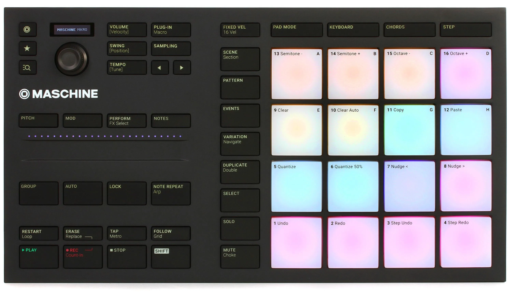

# Maschine-PiMicro

The controller is a "Maschine micro mk3" 

This is normaly bundled with a software pack, i like to make an alternative software which runs as a web app using chrome and the hid api.
The web app shall not imitate the Maschine App, it should be a easy to use sequencer maybe with some ideas from
* playfull PO's ["PocketOperator"](https://teenage.engineering/guides/po-20/en) 
* or the more nerdy performer ["Performer"](https://westlicht.github.io/performer/manual/). (source code ../performer)
It is not supposed to become a full fledged Music studio.

The sounds should be produced in chrome, i'm sure there is some engine for that...
Also keep the posibility to output MIDI via the midi api, so sounds can be played on external gear.

---

When a task is given, look for it's description in the tasks folder. It contains .md files. Names starting with DONE- or TASK-, TASK-s are current things to do, the DONE files can be used as reference to past aktivities.

---

Browser app (Vite + React + TypeScript) that drives a Native Instruments **Maschine Mikro MK3** over **WebHID**.
The device sits on the desk in front of a webcam (`/dev/video0`), so changes can be checked visually.

- `src/maschine/` **the driver** (framework-free, no imports from app/dev, public API in `index.ts`, docs in its README):
  `device.ts` (open, input dispatch, output queue lights-before-screen), `lights.ts` (state = 0x80 report buffer,
  `pad()`/`strip()`/`button()`/`clear()`/`flush()`, `layer(name)` adds layers on top), `screen.ts`, `buttons.ts` / `pads.ts` (input decoding + report layouts),
  `hardware.ts` (ids, button/pad order, colors, `Color`/`LedButton` types)
- `src/shell/` React shell: `App.tsx` (connect, header with app switcher, routing), `route.ts` (`#/<app>/<path>?<params>`),
  `device.ts` (`useDeviceTask()`: runs device tasks one after another across all apps, releases callbacks + lights after),
  `types.ts` (`AppDef` / `AppProps` contract), `index.css` (Tailwind v4, light/dark follows the system)
- `src/apps/` **one folder per idea / app version**, registered in `src/apps/index.ts`:
  - `lab/` light show + hardware test modes (`modes/`: `index.ts` registry, `types.ts` contract, `lightshow.ts`, `tests.ts`)
  - `starter/` template for a new app (copy it)
  - `muop/` μOp, PO-style groovebox, 16 tracks (kinds drums / notes / chords), SELECT + pad selects (`model.ts` song data,
    chords, v1 → v2 migration, localStorage, `sounds.ts` mixer: instrument per track + strip filter + FX bus + volume,
    `sequencer.ts` chain playback + quantized recording + punch-in FX, `fx.ts` PERFORM FX table + track step remapping, `history.ts` undo history (pattern snapshots, gestures), `harmony.ts` key / chords track as harmony source (free / transpose / follow, chord suggestions), `variation.ts` VARIATION generator (Marbles-style déjà vu loops), `favorites.ts` STAR favorites + sound browser list, `page.ts` hold-a-button pages (`Pages`: routing of pads / `< >` / encoder / strip,
    button lights, display, generated cheat sheet), `controller.ts` input mapping / lights / display + the page definitions, `index.tsx` page, `panel.tsx` its right panel: mixer / sound editor / inputs / FX / help, `inputs.ts` audio inputs of this computer).
    Display messages go to the dev log (`event` with `app: 'muop'`).
- `src/engine/` framework-free music engine: `clock.ts` (lookahead scheduler, worker tick, timebase performance.now() ms,
  `onStep` → `{index, time, duration}`, `at(time, fn)` for lights), `audio.ts` (shared AudioContext, `toAudioTime()`,
  unlocked on the first click on the page: pad presses don't count as a user gesture), `metronome.ts`, `midi.ts` (Web MIDI out: ports, timed notes; access requested on demand), `input.ts` (audio inputs via getUserMedia, voice processing off), `fx.ts` (master FX bus for punch-ins: sweeps, gate, pump, echo, reverb, crush, tape stop),
  `instruments/` (sound engines, chosen per track by id: `types.ts` `DrumKit` / `Melodic` contract + `DRUM_ROLES` + `ParamDef` parameters (values per track, live `set()`),
  `basic.ts` plain Web Audio, `tone.ts` Tone.js on our AudioContext, loaded on demand; registry `DRUM_KITS` / `MELODIC` in `index.ts`)
- `src/dev/devlog.ts` dev-only logging to the dev server
- `examples/minimal/` framework-free example page (`/examples/minimal/`); new pages go into `build.rollupOptions.input`
- `vite-plugins/hw-bridge.ts` dev server bridge (below)

## Rules

- **Drive the device only through the browser app.** No Node/hidraw/Python shortcuts that write to `/dev/hidraw*`.
  The point is to build and verify the WebHID app itself.

- Use: vite typescript react.
- App UI: tailwind or daisyUI as needed.

- Do not commit anything, that's a check feature for the chef.


## App conventions (every app in `src/apps/`)

- **Metronome:** SHIFT + TAP toggles it (printed "TAP / Metro"). Use `Metronome` from `src/engine/metronome.ts`
  (`metronome.attach(clock)`); the on/off setting is shared across apps. TAP lit while on, blinking on the beat.
- **Button backlight:** every button the app uses is lit dim (level 1), active / held ones bright (4), unused ones off.
  SHIFT dim when the app has SHIFT combos. Modifiers (hold + pad / encoder) light bright while held.
- **Guide on the app page:** a "Controls" cheat sheet listing every button / pad / encoder / strip function,
  incl. SHIFT + TAP and the light meaning. Keep it in sync with the mapping.
- **Display:** short message on every change (`screen.set`; the driver caps it at 20 fps and sends only the changed area, no debounce needed),
  it auto-blanks after 3 s. Graphics via `screen.draw(ctx => …)`. Keep the blanking (aged OLED): no permanent animations.
- **Audio:** show "click to enable audio" on the page while the AudioContext isn't running (pads don't unlock it).
- **Device ownership:** drive the device via `useDeviceTask()`; use light layers (`m.lights.layer()`) for grid / playhead /
  feedback so they don't wipe each other.
- Reference implementation: `src/apps/muop/`.

## Dev loop

**hw-bridge** (`vite-plugins/hw-bridge.ts`, dev server only) connects the terminal and the browser app:
- Switch the lab mode: `curl 'localhost:9000/__hw/run?mode=<mode>&<params>'`. Modes are in `src/apps/lab/modes/`:
  see the list below. Switch the app: `curl 'localhost:9000/__hw/run?app=<app>[&path=…]'`.
- The app logs to `.devlog/hw.jsonl` (`devlog()` in `src/dev/devlog.ts`): `connected`, `task` (a device task started:
  `lab/<mode>`, `starter`, …), `mode` (confirms a lab mode switch), `event` (test output,
  raw input hex in the input monitor), `error`. Check here first: `tail .devlog/hw.jsonl`.
- After a config change the server restarts and the page reloads. Wait for a fresh `connected` line before sending a mode.
- Inputs (pads/buttons/encoder) need a human. Ask the user, using the `input` mode. The input monitor logs raw hex;
  `mode=replay&from=HH:MM:SS&to=HH:MM:SS[&speed=4]` re-plays recorded input with original timing through the real
  code path (`injectInput`), so input bugs can be reproduced without hands.
- `mode=bench` measures write timing, `mode=stress` checks for lost lights reports (should end all green).
- Modes: `show`, `demo`, `pad-levels`, `strip`, `buttons`, `input`, `events` (m.input edges/held state, `on`/`off`/`full` params), `layers` (light layers + held pads), `clock` (metronome + playhead, timing stats per bar, `bpm`/`swing`), `screen-fps` (screen animation: fps, reports/frame,
  lights latency; `scene=grid|bar|full|text`, `fps`), `screen-rects` (raw rectangle reports, `rects=x:page:w:pages,…`, `pad=1`), `replay`, `bench`, `stress`, `off`.

1. The dev server is usually already running (`npm start` → http://localhost:9000, Chrome/Chromium for WebHID).
   Check before starting another one: `ss -ltnp | grep 9000`.
2. Edit code. `vite.config.ts` forces a **full page reload** on every change (no HMR, which would leave stale HID
   handles and loops running). After the reload the app auto-connects via `navigator.hid.getDevices()` and starts the show.
   - Auto-connect only works once permission was granted via the "Connect to Device" button (user gesture, the user has to click it).
   - The tab must stay visible: background tabs throttle timers to ~1 Hz, so animations crawl.
3. Type-check: `npx tsc` (`npm run build` = tsc + vite build).
4. Look at the device with the camera (below). Don't claim a visual change works without a shot.

## Camera feedback

macOS: the iPhone (Continuity Camera, "mbip Camera") hangs above the desk looking down at the whole device, upright
(display top left, ~150 px wide for its 128 px; only the outer edge of the right pad column may be cut off). It asks for permission on **every** new capture process, so keep
**one** ffmpeg running in the background that overwrites a frame twice a second, and take shots from that file:

```
mkdir -p <scratchpad>/cam && cd <scratchpad>/cam && \
  ffmpeg -f avfoundation -pixel_format nv12 -framerate 30 -i "mbip Camera" -vf fps=2 -q:v 3 -update 1 -y latest.jpg   # run_in_background
# display close-up (crop w:h:x:y needs adjusting when the phone moved; check the full latest.jpg first):
ffmpeg -i <scratchpad>/cam/latest.jpg -vf "crop=200:80:170:243,scale=-1:240:flags=lanczos" shot.jpg
```

- Use the device name, not the index (`-list_devices true -i ""` lists them; indexes change). "mbip Desk View Camera"
  sees the OLED too flat (pale rectangle), the FaceTime camera only sometimes sees the device.
- No zoom / focus / exposure control: macOS has no zoom API, the iPhone exposes no manual modes over Continuity
  (checked with AVFoundation), max 1920×1440. Framing = where the phone is.
- **The image lags ~1–1.5 s** (Continuity + 2 fps): wait ~2 s after a change before reading `latest.jpg`.
- The OLED shows faint burn-in ("Pad / Val: 58"), that's not output.

Linux (`/dev/video0`):

Single shot (creates `shot001.jpg`; skips 15 frames so exposure settles):

```
ffmpeg -f v4l2 -i /dev/video0 -vf "select=gte(n\,15)" -frames:v 1 shot%03d.jpg
```

Time series as one contact sheet: one frame every 4 s over 32 s (= one light show cycle, 4 scenes × 8 s), tiled 4×2:

```
ffmpeg -f v4l2 -i /dev/video0 -vf "fps=1/4,scale=480:-1" -frames:v 8 seq%02d.jpg
ffmpeg -i seq%02d.jpg -vf "tile=4x2" -frames:v 1 contact.jpg
```

- Put shots in the scratchpad, not the repo.
- **Bright LEDs blow out to white** with auto exposure (colors become indistinguishable). Lock exposure for color checks,
  then restore the user's settings:
  ```
  v4l2-ctl -d /dev/video0 -c auto_exposure=1 -c exposure_time_absolute=15 -c gain=40   # manual
  v4l2-ctl -d /dev/video0 -c auto_exposure=3 -c gain=222                               # restore (aperture priority)
  ```
- Rolling shutter: fast strobes can show up half lit (top rows on, bottom off). That's the camera, not a bug.

## Hardware notes (verified on camera)

- Pad input: the device's press event (0x10) needs fairly high pressure (≈400–3300 of 4095 seen). Light touches only come as
  0x40 'touched' pressure updates. Pressure is 12 bit.
- Pads: number 0–15, pad 0 = bottom left (printed label "1"), pad 12 = top left. Row-major from the bottom.
- Touch strip: 25 LEDs (`strip` 0–24, left → right). Touch position 1–200 left → right, 0 = not touched (`STRIP_MAX`).
- Pad/strip level 1–3 (0 = off), byte = 4 × colorIndex + level. Raw level 0 is *not* off (dim); byte 0 is off. `Lights` clamps levels.
- Buttons: brightness 0–4, no color. Raw bytes 0–3 and ≥128 = off, otherwise the low 2 bits count: `01 < 00 < 10 < 11` (hence the table 13, 12, 10, 11). `enc-push` / `enc-touched` have no LED; their indexes land on pad LEDs, so skip them.
- Output timing (measured): LED report 16 ms, screen report ~38 ms, one report on the wire at a time.
  `MaschineMikroMk3` queues all writes, lights first.
- Screen report 0xE0 takes any rectangle (header x / page / width / pages), but must always be the full 264 bytes:
  short reports get paired up (the first is drawn, the next swallowed). `Screen` sends only the changed rectangle,
  capped at `maxFps` 20: changes within 2 rows (8 px each) or ≤ 64 px wide ≈ 20 fps, whole screen ≈ 10 fps. `screen.draw(ctx => …)` for graphics.
- Lights report 0x80 is **80 bytes** (descriptor). Button report: see `src/maschine/buttons.ts` (byte 6 encoder, 9 strip).
- Display shows the current scene name (`maschine.screen.set`), auto-blanks after 3 s.
- Display is an aged OLED (ssd1303 or so) it shall blank after some seconds to save it...
